<picture>
  <source media="(prefers-color-scheme: dark)" srcset="assets/portrait-dark.svg">
  <source media="(prefers-color-scheme: light)" srcset="assets/portrait-light.svg">
  
</picture>

I'm Connor, an MSBAi student at UT Knoxville's Haslam College of Business graduating in May 2027, and I'm looking for analytics engineer and AI solutions engineer roles. I like building the pipeline first and the analysis on top of it. When the answer comes back null, I report the null.

### Featured work

**[US Housing: Buy vs. Rent](https://github.com/connorkersting/us-housing-buy-vs-rent)** · [live app](https://connorkersting.shinyapps.io/us-housing-buy-vs-rent/) · R, Shiny, Zillow Research data 
Change the down payment and the kind of rental you compare against, and the number of US metros where buying costs less per month than renting moves from 0 to 89 (out of 382 to 389, depending on the rent series). Even in the 89 that flip at 20% down, the median household needs 6.4 years to save the down payment. It was a team project for a storytelling course. I did the data work: the prep script over 8 raw Zillow CSVs, every number the app shows, and the method choices. Claude wrote the app skeleton and much of the chart code; the repo's AI log lists which parts.

**[Rocky Top Outfitters data pipeline](https://github.com/AkyuzBurhan/rocky-top-data-pipeline)** · team of 4 · Python, SQLite, GitHub Actions, Streamlit 
A GitHub Action has been loading daily order files since July 7, 2026 (98 of them by October 14). Burhan built the core pipeline; my part was the analysis, verification and docs. On rainy days pickup share rose from 17.9% to 21.6% (z = 2.76) across 3,721 order lines, while the revenue effect was null, and we reported it as null. I also re-ran the current quality gate over every historical raw file and ran the poison-fixture demo, where a deliberately bad file has to trip the gate.

### This profile is a pipeline

<picture>
  <source media="(prefers-color-scheme: dark)" srcset="assets/live-dark.svg">
  <source media="(prefers-color-scheme: light)" srcset="assets/live-light.svg">
  
</picture>

The chart above rebuilds itself on the 20th of every month. A GitHub Action pulls Zillow's home-value and rent indexes, checks both files against a pinned schema, and reconciles metro counts across the join. If any check fails, the run stops without committing and the last good chart stays up. The code is in [pipeline/](pipeline/), with tests in [tests/](tests/).

### How I work

AI coding agents (Claude Code and Codex) write most of my code, this profile's pipeline included. I write the spec, decide which checks the output has to pass, and verify the result against numbers I can reproduce: tests, row-count reconciliation, and a read of the output myself before anything ships. The README in each of my repos says which parts were mine.

[LinkedIn](https://www.linkedin.com/in/connorkersting)
